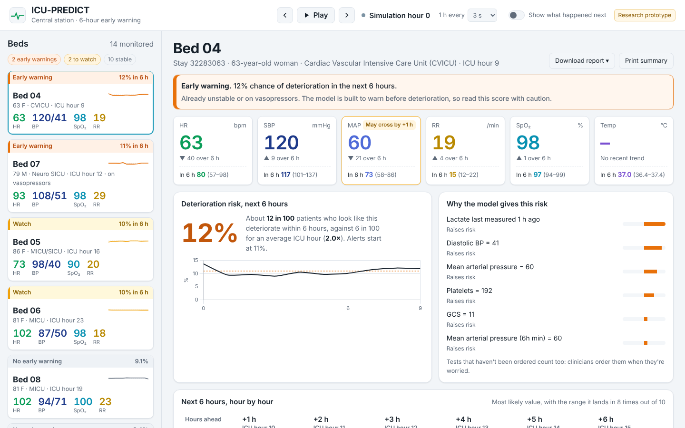
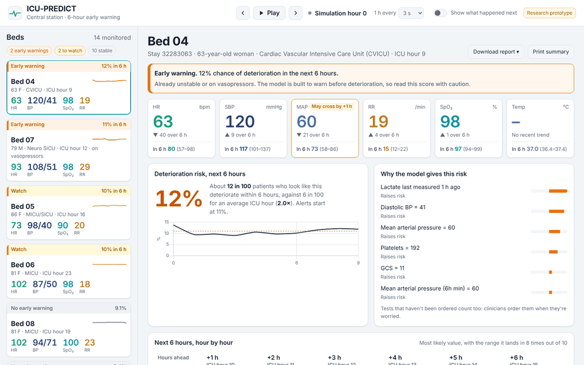
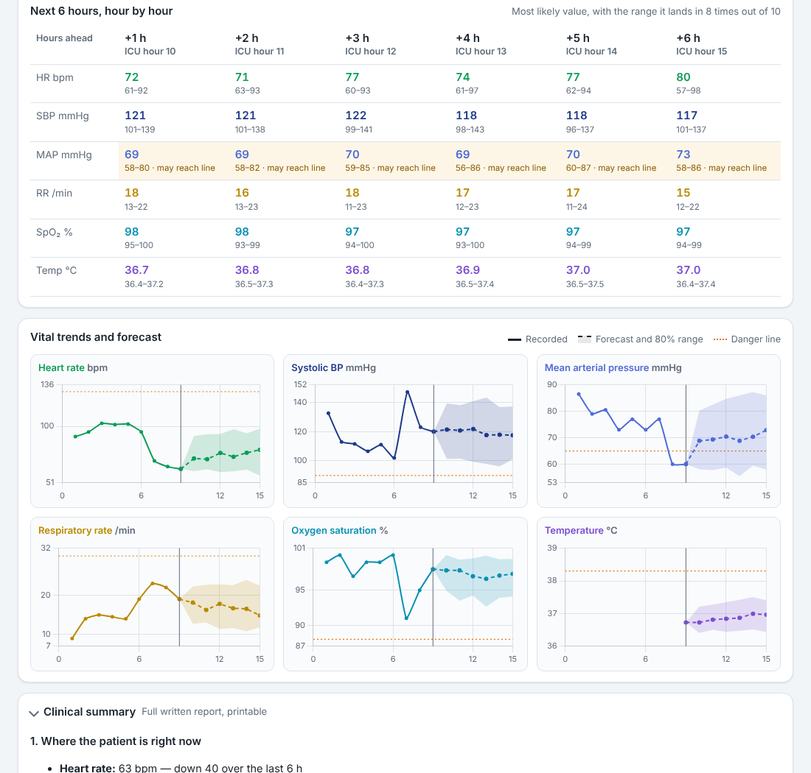

# ICU-PREDICT

**6-hour early warning for ICU patients, trained on MIMIC-IV.** Every hour, for every bed, it estimates the chance a patient deteriorates in the next 6 hours, forecasts each vital sign hour by hour, and explains why, all in a hospital-style monitoring interface.



> Research prototype. Not a medical device, not clinically validated, not for patient care.

| | |
|---|---|
| **Data** | MIMIC-IV v2.x/v3.x (raw `hosp/` + `icu/` tables), or the open 100-patient MIMIC-IV demo |
| **Task** | P(deterioration in the next 6 h) for currently-stable patients, plus vitals forecast at +1 … +6 h |
| **Models** | Logistic regression, XGBoost, LightGBM (selected), GRU sequence benchmark; quantile LightGBM forecasts with conformal ranges |
| **Baseline** | NEWS2, the bedside early-warning score |
| **Serving** | FastAPI + a central-station web UI, PDF/CSV reports, Docker |

---

## What it shows



*Press Play and every bed advances one ICU hour at a time; the bed board re-sorts by urgency as risk changes.*

- **Bed board:** every patient as a mini monitor. Orange bar = early warning, amber = watch.
- **Patient view:** current vitals with their 6-hour trend and forecast, the risk with its history, the reasons behind it, an hour-by-hour table for the next 6 hours, and trend charts with the forecast range.
- **Clinical summary:** a plain-English report ("about 16 in 100 patients who look like this deteriorate within 6 hours…"), downloadable as PDF or CSV.
- **Teaching mode:** "Show what happened next" overlays the real next 6 hours and marks each forecast ✓ or ✗.



---

## How it works

**Labels.** A deterioration event starts at hour *h* if a vasopressor is started, the patient dies in the ICU, or vital signs stay past a danger line (SBP < 90, MAP < 65, HR > 130, RR > 30, SpO2 < 88%, lactate > 4) for 2+ consecutive hours. The prediction at hour *t* is positive if an event starts in hours *t*+1 … *t*+6.

**Design choices that keep the numbers honest**

- **Only currently-stable hours are scored.** Predicting that a crashing patient is crashing is trivial and inflates metrics, so unstable hours, vasopressor hours and hours after the first event are excluded. A first version of this project had 78% positive labels; this definition gives a realistic 5–6%.
- **Negatives need data.** "No event" requires vitals in at least 3 of the 6 future hours, so missing charting isn't read as stability.
- **No look-ahead.** Features at hour *t* only use hours ≤ *t*. A unit test changes future values and checks that no past feature moves.
- **Patient-level splits.** Train, validation and test are split by `subject_id`.
- **Alarm budget, not a sensitivity target.** The alert threshold is set on validation data to about 1.5 alerts per patient-day (amber "watch" at about 4). Clinicians ignore alarms that fire constantly; a fixed 80%-sensitivity target produced 11–17 alerts per patient-day.
- **Small-data safeguards.** Below 500 stays the pipeline runs 5-fold patient-grouped cross-validation (3 repeats) and picks the model from it rather than from a tiny validation set; calibration switches from isotonic to Platt so patients don't collapse onto a few identical risk values.
- **Honest forecast ranges.** Quantile forecasts are widened with conformal calibration on validation patients, so "80% range" covers about 80% of real outcomes (79–90% on the demo).
- **Alert burden reported.** Every model shows AUROC, AUPRC, Brier, ECE, sensitivity, PPV, alerts per patient-day, share of deterioration episodes caught, and lead time.

---

## Results

### Real MIMIC-IV Clinical Database Demo (100 patients)

83 eligible ICU stays → 2,277 prediction points, 6.4% positive. 5-fold patient-grouped CV, 3 repeats:

| Model | AUROC (mean, range) | AUPRC (mean, range) |
|---|---|---|
| **LightGBM (selected)** | **0.695** (0.688–0.700) | **0.200** (0.175–0.214) |
| XGBoost | 0.692 (0.687–0.701) | 0.182 (0.166–0.194) |
| GRU, 12-hour sequence | 0.688 (0.671–0.698) | 0.127 (0.118–0.138) |
| Logistic regression | 0.661 (0.633–0.675) | 0.143 (0.128–0.162) |
| NEWS2 (bedside score) | 0.644 | 0.129 |

**Reading this:** on 83 stays, gradient-boosted trees beat both NEWS2 and the GRU on precision; the GRU ranks risk about as well as the trees but needs more data to pay off. The gaps are small at this size. The full MIMIC-IV (~70,000 ICU stays) is where the comparison becomes meaningful, and the pipeline runs on it unchanged.

Vital forecasts (held-out patients, mean absolute error): heart rate 5.0 bpm at +1 h → 8.7 at +6 h; MAP 6.8 → 8.4 mmHg; SpO2 1.3 → 1.7%. On this small dataset they lean toward "drifting back to normal", so sudden crashes can fall outside the range; the separate risk score is what catches those.

### Synthetic demo data (pipeline check only)

`--demo` generates ~1,700 synthetic stays in the MIMIC-IV layout so everything runs without credentials. Tree models reach AUROC ≈ 0.77 vs 0.70 for NEWS2. These numbers only show the pipeline works.

---

## Quick start

Python 3.10+.

**macOS / Linux**

```bash
python3 -m venv .venv && source .venv/bin/activate
pip install -r requirements.txt
pip install -r requirements-gru.txt          # optional: GRU benchmark (PyTorch)

python run_pipeline.py --demo                # synthetic data, no credentials, ~2 min
# or the open 100-patient MIMIC-IV demo / full MIMIC-IV:
python run_pipeline.py --mimic-dir ~/Downloads/mimic-iv-clinical-database-demo-2.2

python -m uvicorn app.api:app --port 8000    # open http://127.0.0.1:8000
```

**Windows (PowerShell)**

```powershell
python -m venv .venv
.\.venv\Scripts\Activate.ps1                  # if blocked: Set-ExecutionPolicy -Scope Process -ExecutionPolicy Bypass
pip install -r requirements.txt

python run_pipeline.py --demo
# or: python run_pipeline.py --mimic-dir "$HOME\Downloads\mimic-iv-clinical-database-demo-2.2"

python -m uvicorn app.api:app --port 8000
```

To let someone on the same Wi-Fi open it, start with `--host 0.0.0.0` and share `http://<your-IPv4>:8000` (`ipconfig` on Windows). For a temporary public link: `cloudflared tunnel --url http://localhost:8000`.

### Docker

```bash
docker compose up --build                                   # trains on synthetic data, then serves
MIMIC_DIR=~/Downloads/mimic-iv-clinical-database-demo-2.2 docker compose up --build
```

Open <http://127.0.0.1:8000>. The first start trains (a few minutes); models are saved to `./outputs` and reused next time. Set `RETRAIN=1` to train again. Build with `--build-arg WITH_GRU=true` to include the GRU benchmark.

### Host it online

Only the open MIMIC-IV demo or synthetic data should ever be hosted publicly. Every hosted version downloads the open demo itself while it builds, trains, and serves the UI on port 7860 (synthetic data if PhysioNet is unreachable); the footer says which data it shows. The app needs about 160 MB of memory to serve and about 650 MB while training.

**Azure Container Apps** (free for students: $100 credit, no card, via <https://azure.microsoft.com/free/students>)

```powershell
python scripts/make_space.py                # writes ../icu-predict-space (Docker version)
cd ..\icu-predict-space
az login
az extension add --name containerapp --upgrade
az containerapp up --name icu-predict --resource-group icu-predict-rg --location eastus --source . --target-port 7860 --ingress external
```

It prints the public URL when done. Run the same command to update; `az group delete --name icu-predict-rg` removes everything.

**Hugging Face Spaces** (free). Pick **CPU basic** hardware when creating the Space; ZeroGPU only works with Gradio and can't be downgraded on a free account.

```bash
python scripts/make_space.py            # Docker Space   -> ../icu-predict-space
python scripts/make_space.py --gradio   # Gradio Space   -> ../icu-predict-space-gradio (if Docker isn't offered)
```

Upload the *contents* of the generated folder so `README.md` is at the top level; its first line must be `---`.

### Full MIMIC-IV

1. Create a PhysioNet account, complete the CITI "Data or Specimens Only Research" course, and sign the MIMIC-IV data use agreement at <https://physionet.org/content/mimiciv/>.
2. Download `hosp/` and `icu/` (keep the `.csv.gz` files):
   `wget -r -N -c -np --user YOUR_USERNAME --ask-password https://physionet.org/files/mimiciv/3.1/`
3. `python run_pipeline.py --mimic-dir /path/to/physionet.org/files/mimiciv/3.1`

Expect 15–40 minutes and 8–16 GB RAM; `chartevents` is scanned with DuckDB and filtered to the needed item IDs. Never commit MIMIC-IV or anything derived from it (`data/` and `outputs/` are git-ignored), and don't send it to third-party APIs or hosted LLMs.

---

## Interfaces

| URL | What |
|---|---|
| `/` | Central monitoring station (main UI) |
| `/dashboard` | Optional light single-patient dashboard |
| `/docs` | Interactive API docs |
| `POST /predict` | Score a patient from hourly history (risk, forecasts, reasons, report) |
| `GET /api/patient/{stay_id}?hour=16` | Full prediction for a stay at an hour |
| `GET /api/patient/{stay_id}/report.pdf?hour=16` | PDF report |
| `GET /api/ward?t=0` | All beds at simulation hour *t* |

```bash
curl -X POST http://127.0.0.1:8000/predict -H "Content-Type: application/json" -d '{
  "patient": {"age": 71, "male": 1, "emergency_admission": 1},
  "history": [
    {"heart_rate": 86,  "sbp": 124, "dbp": 70, "resp_rate": 17, "spo2": 97, "temp_c": 37.2, "lactate": 1.8},
    {"heart_rate": 98,  "sbp": 112, "dbp": 66, "resp_rate": 21, "spo2": 95},
    {"heart_rate": 104, "sbp": 106, "dbp": 64, "resp_rate": 23, "spo2": 94, "temp_c": 37.9}
  ]}'
```

There is also a Streamlit analysis app: `python -m streamlit run app/dashboard.py`.

---

## Project structure

```text
icu-predict/
├── run_pipeline.py              # extract → dataset → train → forecast → plots
├── config.yaml                  # cohort, labels, thresholds, alert budget, models
├── Dockerfile, docker-compose.yml, docker-entrypoint.sh
├── app/
│   ├── api.py                   # FastAPI: UI, prediction, ward, PDF endpoints
│   ├── static/                  # central station (station.html, app.js, styles.css) + light dashboard
│   └── dashboard.py             # Streamlit analysis app
├── src/icu_predict/
│   ├── data/                    # MIMIC-IV extraction (DuckDB), synthetic data generator
│   ├── features/                # leak-free hourly features, labels, forecast targets
│   ├── models/                  # training + CV, GRU benchmark, forecasts, plots, metrics
│   └── inference/               # predictor (shared by API and UIs), PDF report
├── tests/                       # label logic, leakage, alert budget, end-to-end run
└── docs/images/                 # screenshots used in this README
```

```bash
python -m pytest                  # includes an end-to-end run on generated data
python -m pytest -m "not slow"    # fast unit tests only
```

---

## Limitations and next steps

- Labels are physiological proxies; validate against chart review or established definitions (Sepsis-3 onset, rapid-response calls).
- Run on full MIMIC-IV, then validate externally (eICU-CRD) and check subgroup performance.
- On small data some explanations are noise (e.g. care unit raising risk); they should stabilise with more data.
- Add medications, ventilation and fluid balance as features; try a transformer once data size allows.

## Data and disclaimer

Screenshots use the MIMIC-IV Clinical Database Demo v2.2 (Johnson et al., PhysioNet, ODbL license). ICU-PREDICT is an educational research prototype. It is not a medical device and must not be used to diagnose, monitor or treat patients.

Built by Roshini Evangelin Tamanamu ([@RoshiniEvangelin](https://github.com/RoshiniEvangelin)).
